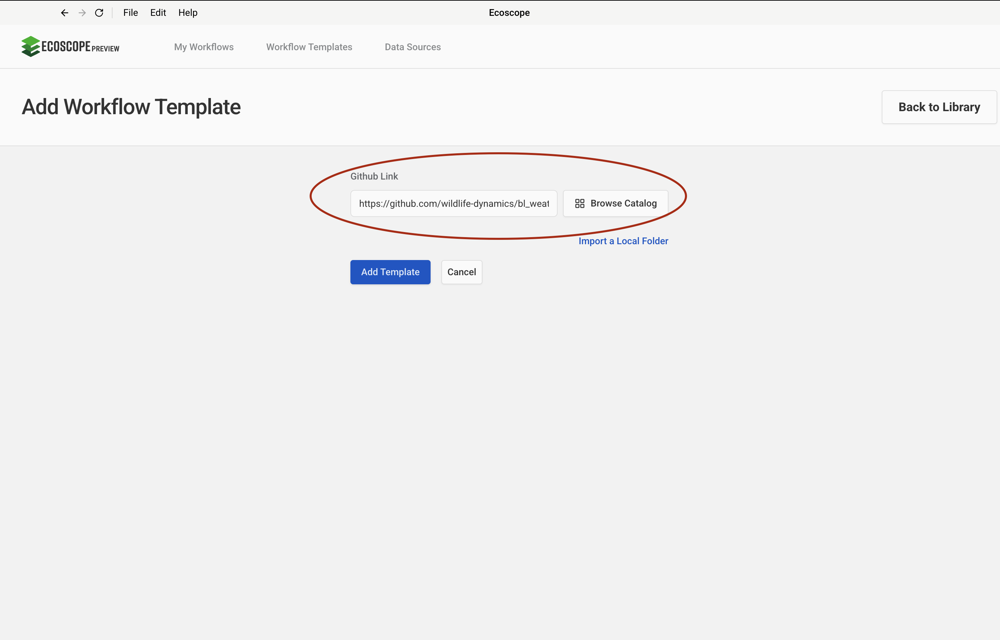
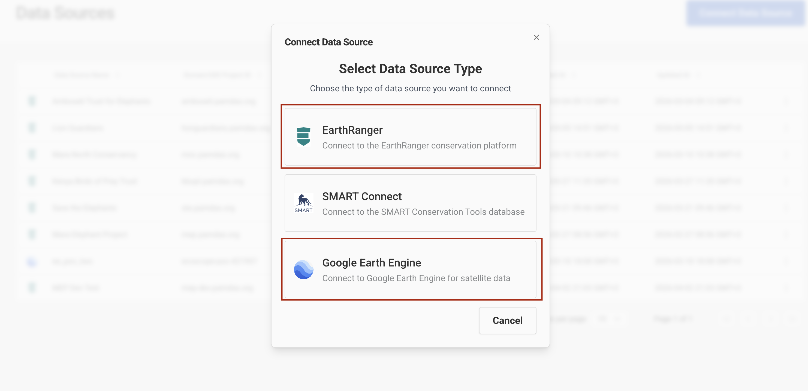
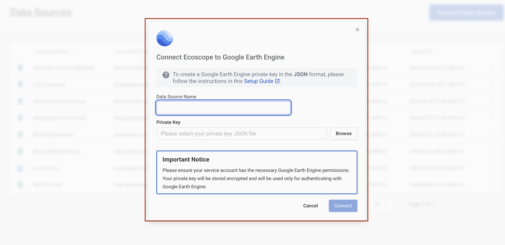
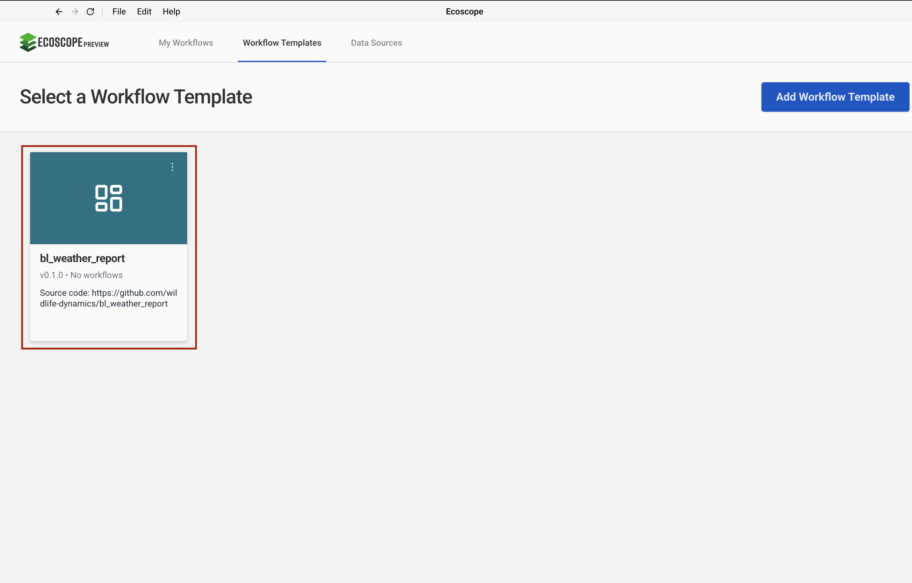
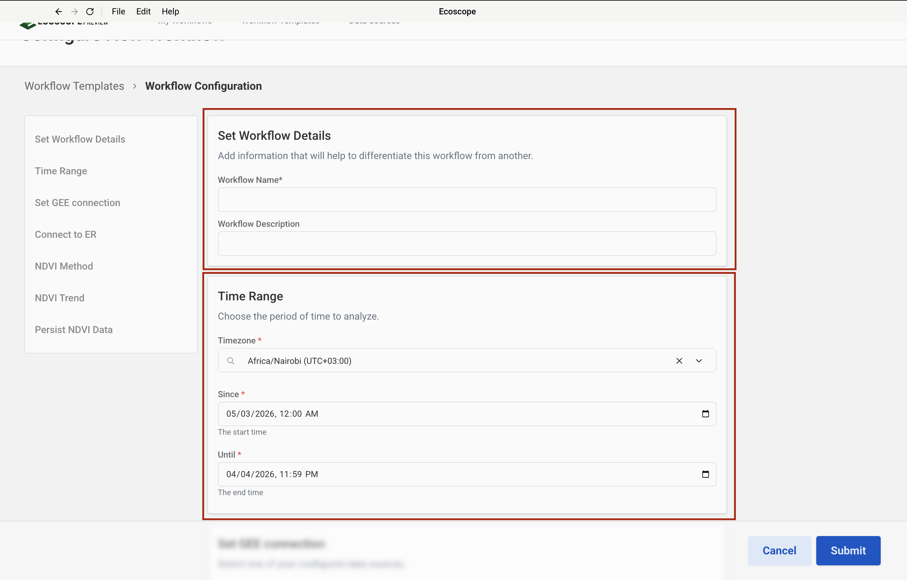
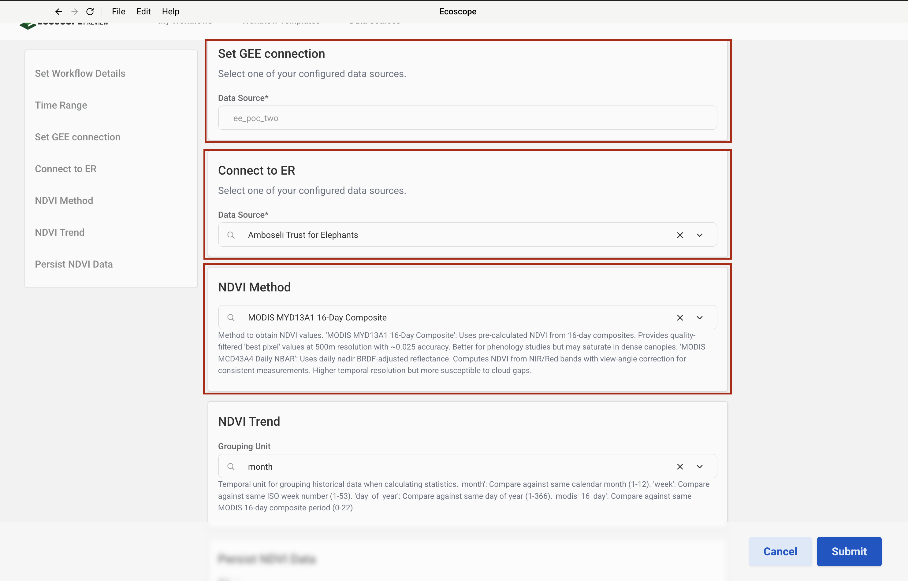
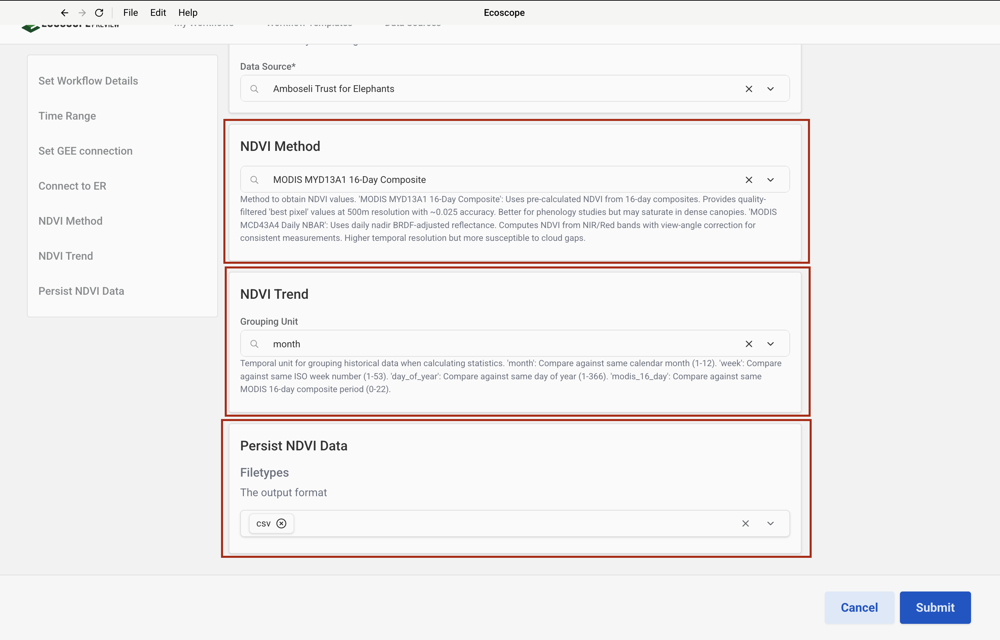

# BL Weather Report — User Guide

This guide walks you through configuring and running the Big Life Weather Report workflow, which ingests rainfall gauge observations from EarthRanger, derives NDVI vegetation condition from Google Earth Engine, and produces an automated weather report for the Amboseli ecosystem.

---

## Overview

The workflow delivers, for each run:

- An **overall rainfall bar chart** — total millimetres per gauge station for the analysis period
- A **monthly stacked bar chart** — month-by-month rainfall breakdown per station
- An **interactive rainfall map** — proportional-symbol map of readings across stations
- **Per-ranch NDVI time-series charts** — current NDVI overlaid against the historic min/max/mean range
- **Data files** — aggregated station readings (GeoPackage) and NDVI time-series (CSV) per ranch
- A **Word document report** — all charts and the map embedded in the Big Life weather report template

---

## Prerequisites

Before running the workflow, ensure you have:

- Access to an **EarthRanger** instance with `rainfall_rep` events logged for the analysis period
- Access to a **Google Earth Engine** service account with a private key in JSON format

---

## Step-by-Step Configuration

### Step 1 — Add the Workflow Template

In the workflow runner, go to **Workflow Templates** and click **Add Workflow Template**. Paste the GitHub repository URL into the **Github Link** field:

```
https://github.com/wildlife-dynamics/bl_weather_report.git
```

Then click **Add Template**.



---

### Step 2 — Configure Connection

Navigate to **Data Sources** and click **Connect**. A dialog will appear prompting you to **Select Data Source Type**. This workflow requires two connections:

| Data Source Type | Purpose |
|-----------------|---------|
| **EarthRanger** | Pull rainfall gauge events (`rainfall_rep`) |
| **Google Earth Engine** | Compute per-ranch NDVI time-series against historic baselines |

Select **EarthRanger** first and complete Step 3, then repeat and select **Google Earth Engine** for Step 4.



---

### Step 3 — Add an EarthRanger Connection

After selecting **EarthRanger** in Step 2, fill in the connection form:

- **Data Source Name** — a label to identify this connection
- **EarthRanger URL** — your instance URL (e.g. `your-site.pamdas.org`)
- **EarthRanger Username** and **EarthRanger Password**

> Credentials are not validated at setup time. Any authentication errors will appear when the workflow runs.

Click **Connect** to save.


---

### Step 4 — Add a Google Earth Engine Connection

After selecting **Google Earth Engine** in Step 2, fill in the connection form:

- **Data Source Name** — a label to identify this connection
- **Private Key** — click **Browse** to select your GEE service account private key file (JSON format)

> To generate a private key, follow the instructions in the [Setup Guide](https://developers.google.com/earth-engine/guides/service_account). The key is stored encrypted and used only to authenticate with Google Earth Engine.

Click **Connect** to save.



---

### Step 5 — Select the Workflow

After the template is added, it appears in the **Workflow Templates** list as **bl_weather_report**. Click it to open the workflow configuration form.

> The card may show **Initializing…** briefly while the environment is set up.



---

### Step 6 — Set Workflow Details and Time Range

The configuration form opens with two sections at the top.

**Set Workflow Details**

| Field | Description |
|-------|-------------|
| Workflow Name | A short name to identify this run |
| Workflow Description | Optional notes (e.g. month, ranger station, or site name) |

**Time Range**

| Field | Description |
|-------|-------------|
| Timezone | Select the local timezone (e.g. `Africa/Nairobi UTC+03:00`) |
| Since | Start date and time of the analysis period |
| Until | End date and time of the analysis period |

Rainfall events and NDVI data are both fetched for this window.



---

### Step 7 — Set GEE Connection, Connect to ER, and NDVI Method

Scroll down to configure the next three sections.

**Set GEE connection**

Select the Google Earth Engine data source configured in Step 4 from the **Data Source** dropdown.

**Connect to ER**

Select the EarthRanger data source configured in Step 3 from the **Data Source** dropdown (e.g. `Amboseli Trust for Elephants`).

**NDVI Method**

Choose the MODIS satellite product to use for NDVI calculations:

| Option | Description |
|--------|-------------|
| **MODIS MYD13A1 16-Day Composite** *(default)* | Pre-calculated NDVI from 16-day composites. Quality-filtered best-pixel values at 500 m resolution with ~0.025 accuracy. Better for phenology studies but may saturate in dense canopies. |
| **MODIS MCD43A4 Daily NBAR** | Computes NDVI from NIR/Red bands with view-angle correction for consistent measurements. Higher temporal resolution but more susceptible to cloud gaps. |



---

### Step 8 — NDVI Trend and Persist NDVI Data

**NDVI Trend**

Configure how historical NDVI data is grouped when computing the baseline statistics (min, max, mean) to compare against the current period:

| Grouping Unit | Behaviour |
|--------------|-----------|
| **month** *(default)* | Compare against the same calendar month (1–12) |
| **week** | Compare against the same ISO week number (1–53) |
| **day_of_year** | Compare against the same day of year (1–366) |
| **modis_16_day** | Compare against the same MODIS 16-day composite period (0–22) |

**Persist NDVI Data**

| Field | Default | Description |
|-------|---------|-------------|
| Filetypes | `csv` | Output format for the per-ranch NDVI time-series data file |

The NDVI data file is always written for each ranch even if other parts of the workflow are skipped.



---

## Running the Workflow

Once all parameters are configured, click **Submit**. The runner will:

1. Download the three Amboseli geospatial layers (land use, ranch boundaries, electric fence) from Dropbox.
2. Fetch `rainfall_rep` events from EarthRanger for the specified time range.
3. Normalise, clean, and aggregate rainfall readings by gauge station.
4. Render the overall rainfall bar chart, monthly stacked bar chart, and rainfall map.
5. Split the Amboseli conservancy boundaries by ranch name and run NDVI analysis per ranch via Google Earth Engine.
6. Render historic NDVI time-series charts per ranch.
7. Look up the current EarthRanger user's name for report attribution.
8. Populate the Big Life weather report Word template with all charts and the map.
9. Save all outputs to the directory specified by `ECOSCOPE_WORKFLOWS_RESULTS`.

---

## Output Files

All outputs are written to `$ECOSCOPE_WORKFLOWS_RESULTS/`:

| File | Description |
|------|-------------|
| `overall_rainfall_station_readings.gpkg` | Total rainfall per station with point geometry |
| `monthly_rainfall_station_readings.gpkg` | Total rainfall per station per month |
| `ndvi_<ranch>.csv` | NDVI time-series with historic min/max/mean per ranch |
| `rainfall_readings_over_time.html` / `.png` | Overall rainfall bar chart |
| `monthly_rainfall_readings.html` / `.png` | Monthly stacked bar chart |
| `rainfall_map.html` / `.png` | Interactive proportional-symbol rainfall map |
| `<ranch>_ndvi.html` / `.png` | Historic NDVI time-series chart per ranch |
| `big_life_weather_report.docx` | Final populated Word weather report |
