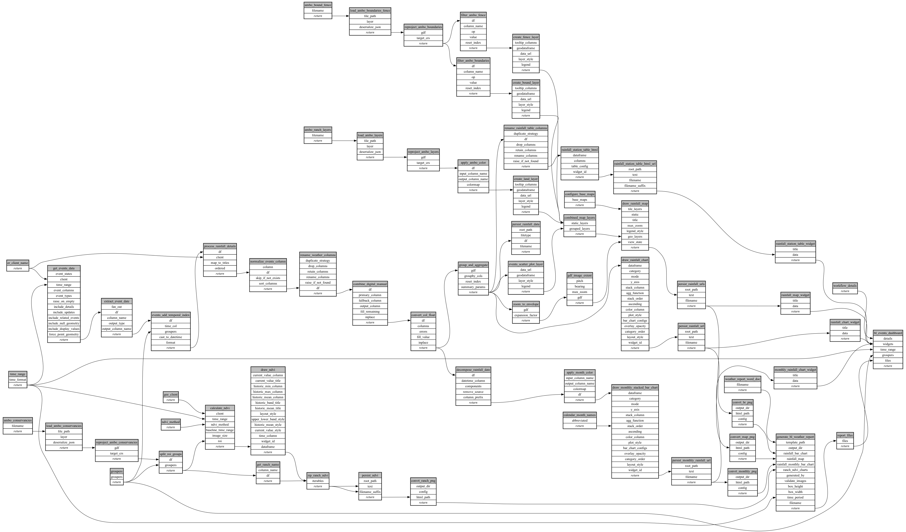

```
# AUTOGENERATED BY ECOSCOPE-WORKFLOWS; see fingerprint in README.md for details

```

```yaml
# fingerprint:
artifacts_sha256_basic: 9d88529ef244228187651f2678c88efd51719c798c056f5853d35eb4902e505a
artifacts_sha256_strict: 1ab1a706f738dfa5752d810d47c0a7c10805914d8eca58274235a1d73ee16cd3
installed_requirements:
- channel: https://repo.prefix.dev/ecoscope-workflows/
  name: ecoscope-platform
  version: {version: ==2.28.0}
- channel: https://repo.prefix.dev/ecoscope-workflows-custom/
  name: ecoscope-workflows-ext-custom
  version: {version: ==0.1.4}
- channel: https://repo.prefix.dev/ecoscope-workflows-custom/
  name: ecoscope-workflows-ext-ste
  version: {version: ==0.0.24}
- channel: https://repo.prefix.dev/ecoscope-workflows-custom/
  name: ecoscope-workflows-ext-mnc
  version: {version: ==1.0.0}
- channel: https://repo.prefix.dev/ecoscope-workflows-custom/
  name: ecoscope-workflows-ext-wwf-virunga
  version: {version: ==1.0.1}
- channel: https://repo.prefix.dev/ecoscope-workflows-custom/
  name: ecoscope-workflows-ext-big-life
  version: {version: ==1.4.1}
- channel: conda-forge
  name: pydeck
  version: {version: ==0.9.2}
- channel: conda-forge
  name: opentelemetry-sdk
  version: {version: ==1.45.2}
params_sha256: 279a25593f03db25dab95f44a204b6b6ee4d6491f2000b22c23d78e9697bf75e
spec_sha256: 1faebc71c1050ca1f0e3b9530c3f3227c85d8fa96ee4f16d01fe59094217ccae

```

# ecoscope-workflows-bl-weather-report-workflow


